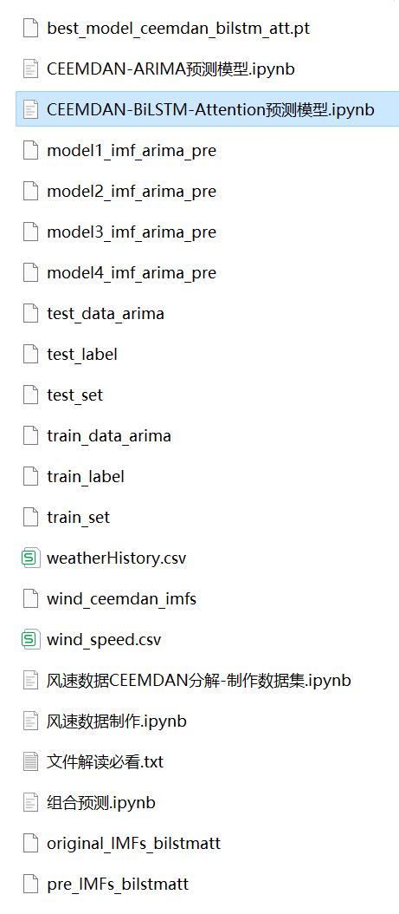
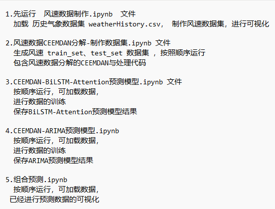
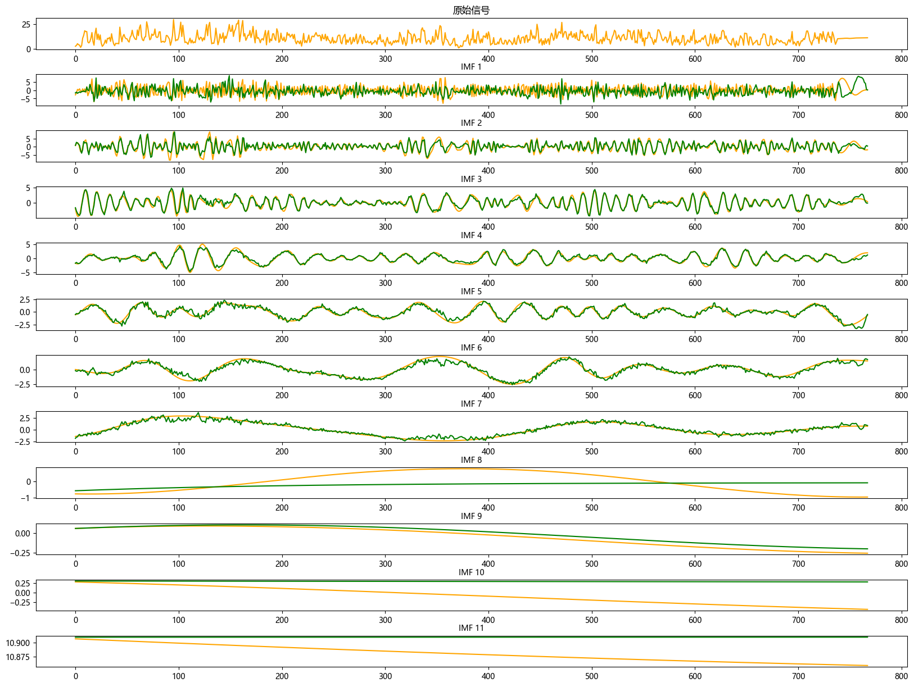

# CEEMDAN +(BiLSTM-Attention+ARIMA) Combination Forecasting Model

The method of Comprehensive Ensemble Model (CEEMDAN) and hybrid prediction model (BiLSTM-Attention + ARIMA) is proposed to improve the predictive performance of time series data. The core of this method is to use the CEEMDAN algorithm to decompose the time series, then utilize the BiLSTM-Attention model and ARIMA model to model the decomposed data, finally combine the predictions of both models through an ensemble method.

This includes wind speed data, as well as the wind speed dataset and label set that have been generated and processed by CEEMDAN decomposition, corresponding codes can be run, and there are also examples of CEEMDAN decomposition.

The BiLSTM-Attention + ARIMA model has smaller MSE and MAE, and the effect is particularly obvious.

This includes code for preprocessing the data with CEEMDAN, and complete BiLSTM-Attention model prediction code, ARIMA prediction model code, visualization code.

Environment: Python 3.9

## Images

<!-- PAYMENT_BLOCK -->

## Get this dataset

- Payment link (Stripe): [Buy now](https://buy.stripe.com/3cs8yP7sY87d0vu9AB)
- Payment QR code: 

<!-- /PAYMENT_BLOCK -->
